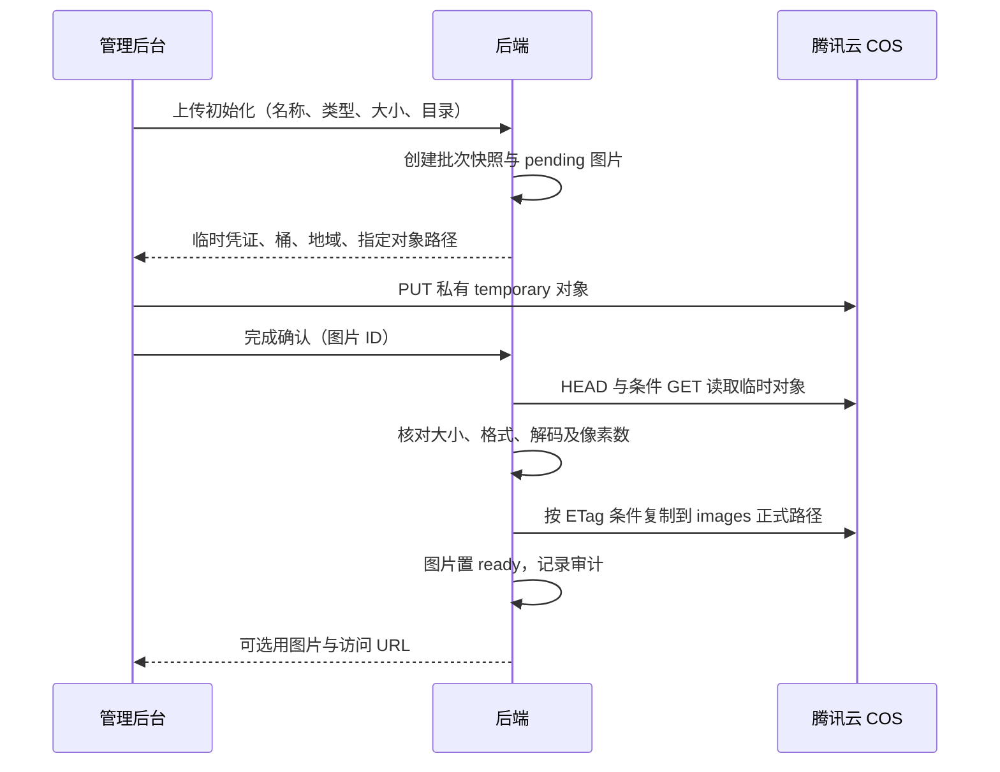

# 图片媒体库

媒体库仅管理 JPEG、PNG、WebP、GIF 图片，文件保存在腾讯云对象存储（Cloud Object Storage，COS）。管理后台、商品图片、检测报告图片、正文插图、Banner、品牌 Logo 和客服二维码共用媒体库，不提供视频资源或转码功能。

## 目录与操作

目录交互参考 kpclive，采用单层目录：全部图片、未分组和自定义目录。目录可新增、重命名、删除；名称去首尾空白、最多 200 个字符、不区分大小写唯一。系统目录不可编辑。删除自定义目录只将图片归入未分组，不删除图片。移动目录不改变 COS 对象路径、图片 URL 或业务引用。

媒体库与选图弹窗共用目录、搜索、分页和预览。可重命名、查看引用、批量移动和批量删除；批量操作最多 100 张，有任一图片正在被业务引用时整批删除失败。删除图片与新增引用共享数据库行锁，避免并发生成悬空引用。

上传队列在后台页面切换时保留，支持进度、速度、暂停、继续、取消和重试，同时最多上传 3 张。暂停会中止当前单次 PUT，继续从头上传该图片。刷新页面或退出登录不保留本地文件队列；有未完成任务时提示离开风险。

## 上传流程



临时安全凭证（Security Token Service，STS）仅授予本批次指定临时对象的 PutObject 权限，并限制内容长度。长期密钥不返回浏览器。浏览器不能写正式图片路径；后端校验后的条件复制防止校验期间对象被替换。

默认图片上限 20 MiB，配置允许范围为 1 字节至 64 MiB；解码像素上限 2000 万。后端初始化每批最多 20 张，当前后台队列逐文件初始化。后缀、声明 MIME、实际内容须一致，不接受 SVG、PDF、视频。图片名称最多 200 个字符。

凭证有效期 30 分钟，批次有效期 24 小时。队列在凭证接近过期时续期；只有上传者可以续期、完成或取消，续期只授权待完成图片。批次保存桶、地域、域名、前缀和大小限制快照，配置热加载不会改变已有批次的归属。关闭 cos.enabled 只禁止新批次；保留有效密钥可继续完成、续期及清理旧批次。

上传状态为 pending、ready、failed、canceled。只有 ready 且可用、未删除的图片出现在列表并允许业务引用。完成确认幂等；网络错误可重试，校验失败终止该图片上传。客户端取消不保证即时撤销已签发的云凭证，因此不提前清理临时路径。

批次创建 25 小时后开始清理临时对象与未完成记录。每个对象清理成功后独立记录进度，超时或网络失败可续跑。逻辑删除立即从业务接口隐藏，物理删除由既有清理任务重试；公开 URL 或 CDN 缓存不保证即时失效。

## 数据与权限

migration `000015_media_cos` 新建 media_group、media_upload_batch，给 media 增加 group_id、storage_provider、status、batch_id、temporary_cleaned。目录和上传状态使用数据库管理，不创建 COS 空文件夹。历史记录默认 local、ready、未分组。表之间使用逻辑引用，不增加外键。

接口前缀为 `/admin/api/v1/media`，ID 使用十进制字符串。写请求沿用登录会话、来源校验、`X-Requested-With: peptide-admin` 和权限中间件。

| 接口 | 用途 | 权限 |
| --- | --- | --- |
| GET /、GET /{id}、GET /upload-policy | 列表、详情、有效策略 | media.read |
| GET /groups、GET /{id}/references | 目录及数量、引用 | media.read |
| POST /upload/init、POST /upload/refresh | 初始化、凭证续期 | media.upload |
| POST /{id}/complete、POST /{id}/cancel | 完成、取消 | media.upload |
| POST /groups、PATCH /groups/{id}、DELETE /groups/{id} | 目录管理 | media.update |
| PATCH /{id}、POST /batch-move | 重命名、移动 | media.update |
| DELETE /{id}、POST /batch-delete | 删除图片 | media.delete |

列表支持 page、pageSize、q 和 groupId；groupId 省略表示全部、ungrouped 表示未分组。初始化请求为 `{files:[{name,mime,size}],groupId}`；groupId 为字符串或 null。续期请求为 `{batchId}`。移动请求为 `{ids:["1"],groupId:null}`，删除请求为 `{ids:["1"]}`。目录创建及重命名请求为 `{name}`。旧 POST /media 本地上传入口不再使用。

| 错误码 | 含义 |
| --- | --- |
| COS_NOT_CONFIGURED | COS 上传或访问凭据不可用 |
| MEDIA_GROUP_EXISTS | 目录名称已存在 |
| MEDIA_IN_USE | 图片被业务引用，不能删除 |
| MEDIA_UPLOAD_EXPIRED | 批次过期，需要重新上传 |
| MEDIA_UPLOAD_STATE | 当前状态不允许该操作 |
| MEDIA_FILE_INVALID | 实际文件不符合图片声明或限制 |

其他参数、权限和不存在错误沿用现有统一错误协议。新增审计操作涵盖目录增改删、移动、上传初始化／完成／失败／取消、删除与迁移；没有新增权限点，部署时必须 seed 更新现有权限的路由登记。

## 配置与部署

私有 YAML 的 `data.storage.cos` 包含 enabled、secret_id、secret_key、bucket、region、public_domain、key_prefix；示例见 `backend/configs/config.local.example.yaml`。未配置时保持 enabled=false，不回退本地上传。密钥仅填写私有配置，不提交仓库。

- bucket 使用带 APPID 的完整桶名，region 使用桶所在地域；public_domain 使用可访问图片的 HTTPS 域名，无路径、查询参数或凭据。
- key_prefix 使用站点专属前缀。桶保持私有，仅允许匿名读取此前缀下的 images 正式图片；temporary 路径必须保持私有。后端身份需有临时凭证签发及指定前缀的读、写、复制、删除权限。
- 跨域资源共享（Cross-Origin Resource Sharing，CORS）限定管理后台 Origin，允许 PUT，AllowedHeaders 可设为 *，ExposeHeaders 包含 ETag。需要浏览器跨域读取图片时再加入对应 GET/HEAD。规则含义以 [腾讯云 CORS 文档](https://cloud.tencent.com/document/product/436/8279)为准。
- 建议为 temporary 前缀配置 7 天对象过期规则，兜底清理极端延迟写入；不要对 images 前缀配置这一规则。确认正式图片的 CDN 或域名回源路径保持对象 key。
- 临时凭证按精确资源与最小权限申请，依据 [腾讯云临时密钥指引](https://cloud.tencent.com/document/product/436/14048)。自定义图片域名应先验证浏览器预览，参见 [腾讯云域名提示](https://cloud.tencent.com/document/product/436/35651)。

部署顺序：备份数据库和媒体文件 → 配置私有 YAML 与云侧权限 → 停止旧服务并执行 migration → seed 更新权限路由 → 启动新后端 → 发布新后台及官网。当前可以先保持 COS 禁用完成代码部署。开启后验证一次图片直传、选用、网页显示、引用删除保护、取消与清理。

切换密钥后，新请求使用新密钥；仍有旧批次或图片时，新身份必须保留其所在桶和路径的读写、清理权限。更换域名不会重写已有图片 URL 或批次快照，应保留历史域名可访问性。

## 历史图片迁移

现有本地图片继续可用。迁移是独立显式命令，不随启动自动执行。先执行 migration 并备份数据库、所有 storage_root 目录和 COS 对象；在 backend 目录盘点：

```sh
go run ./cmd/media-migrate -conf /path/config.yaml
```

确认 COS 配置启用后执行复制：

```sh
go run ./cmd/media-migrate -conf /path/config.yaml -apply
```

命令按图片逐条上传和回读验证，成功后更新存储元数据，保留媒体 ID、引用和原 URL。原 `/uploads/...` 地址经后端 307 跳转到 COS，因此历史正文无需改写。原本地文件保留，重复执行跳过已迁移图片；失败可重跑，确定性对象 key 避免重复产生正式图片。验证失败时数据库记录保留原状；已写入的迁移对象可由重跑覆盖并验证。

不迁移或删除历史非图片文件。业务数据中如有历史视频内容，应单独盘点；本次不执行破坏性清库。存在任何 COS 媒体记录时 down SQL 会拒绝回滚，避免丢失云对象归属；生产恢复使用配套备份。

## 验证记录

2026-10-13：本地真实 PostgreSQL 的全量 `go test -race ./...` 通过，覆盖目录唯一性／归组、引用与删除竞争、上传所有权／状态／过期、坏图拒绝、批次配置快照、清理超时进度和迁移引用及本地文件保留。COS SDK 适配层使用 HTTP 测试服务验证精确权限、ETag 条件读取和复制；云对象生命周期使用测试替身，不代表真实腾讯云联调。

后台与官网完成 TypeScript 检查和生产构建。尚未配置真实 COS 桶、密钥与域名，真实直传、CORS、公开图片访问与云侧清理待配置补齐后验证；本次不执行真实对象迁移或生产发布。
